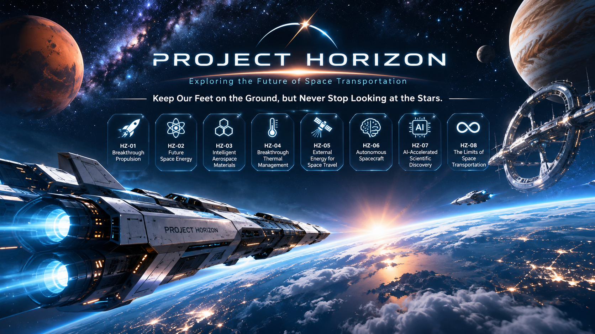

  

# Project Horizon
### Exploring the Future of Space Transportation

> **Keep Our Feet on the Ground, but Never Stop Looking at the Stars.**

---

## Our Vision

Humanity has always looked to the stars.

From the first aircraft to the first spacecraft, every great achievement began with someone asking: *What if we could go further?*

Project Horizon is an open, long-term research initiative exploring the future of space transportation through science, engineering, and artificial intelligence.

We aim to investigate new possibilities in propulsion, energy, materials, autonomous spacecraft, and scientific discovery.

We understand that many of these challenges may take decades or even generations to solve.

**We are not claiming to have solved the challenges of space exploration. We are documenting the questions, conjectures, and research pathways that may help future generations solve them.**

## Our Mission

Our mission is to:

- Explore the scientific and engineering boundaries of space transportation.
- Formulate ambitious but testable scientific conjectures.
- Investigate advanced propulsion and future energy technologies.
- Apply AI to accelerate scientific research and engineering.
- Build open knowledge that can be shared, challenged, and improved.
- Preserve today's ideas and research for future generations.

## Eight Foundational Conjectures

These eight conjectures represent the questions that guide Project Horizon. They are research directions, not established scientific discoveries.

### HZ-01 — Breakthrough Propulsion

**Can we develop propulsion systems that are far more efficient and powerful than today's technologies?**

Explore advanced electric propulsion, plasma propulsion, nuclear propulsion, and other future possibilities.

### HZ-02 — Future Space Energy

**Can we build lighter energy systems that deliver much more power?**

Explore high-specific-power energy systems, advanced power conversion, and energy storage for spacecraft.

### HZ-03 — Intelligent Aerospace Materials

**Can materials become stronger, lighter, smarter, and capable of repairing themselves?**

Explore advanced materials that can withstand extreme temperatures, radiation, and harsh space environments.

### HZ-04 — Breakthrough Thermal Management

**Can we manage extreme heat more effectively in space?**

Explore advanced thermal protection, heat transfer, energy recovery, and lightweight heat rejection systems.

### HZ-05 — External Energy for Space Travel

**Can spacecraft receive energy from outside rather than carrying all their energy onboard?**

Explore laser propulsion, light sails, microwave power transmission, and space-based energy systems.

### HZ-06 — Autonomous Spacecraft

**Can spacecraft think, adapt, and make decisions independently?**

Explore AI-powered navigation, autonomous operations, fault diagnosis, and intelligent mission planning.

### HZ-07 — AI-Accelerated Scientific Discovery

**Can AI help humanity discover scientific principles and technologies that we have not yet imagined?**

Use AI to generate hypotheses, explore scientific models, design experiments, and challenge existing assumptions.

### HZ-08 — The Limits of Space Transportation

**What are the true physical limits of space travel, and which limits can future technology overcome?**

Investigate the boundaries imposed by physics while exploring new scientific and engineering possibilities.

---

## Our Research Approach

Project Horizon follows two complementary research tracks.

| Engineering Track | Frontier Research Track |
|---|---|
| Build on established physics | Explore unresolved scientific questions |
| Develop mathematical models | Formulate new conjectures |
| Design and simulate systems | Investigate breakthrough technologies |
| Test and validate engineering solutions | Search for experimental evidence |

AI research infrastructure will support both tracks through knowledge retrieval, simulation, data analysis, hypothesis generation, and critical evaluation.

## Our Principles

- **Think Beyond Today:** Explore possibilities beyond current engineering capabilities.
- **Respect Physics:** Respect established scientific laws and evidence.
- **Test, Don't Assume:** Every scientific hypothesis should lead to testable predictions.
- **Evidence Before Claims:** Distinguish speculation, theory, simulation, experiment, and engineering validation.
- **AI Accelerates Discovery:** Use AI as a research partner, not a replacement for scientific validation.
- **Open Research:** Share knowledge, invite criticism, and learn from failure.
- **Think Long Term:** Preserve ideas and research for future generations.

## An Open Invitation

Project Horizon is an open research journey.

Scientists, engineers, developers, students, and curious minds are welcome to explore these questions, challenge our assumptions, contribute ideas, and help turn possibilities into research.

We do not expect every conjecture to be correct. Some may be refined, some may be disproved, and others may inspire entirely new directions.

That is part of the scientific process.

## A Message to Future Generations

We may not be the generation that reaches the next frontier of space exploration.

But perhaps we can be the generation that asks some of the questions that make it possible.

**The future belongs to those who dare to explore what does not yet exist.**

---

*Project Horizon — Think Beyond Today. Build for Tomorrow.*

